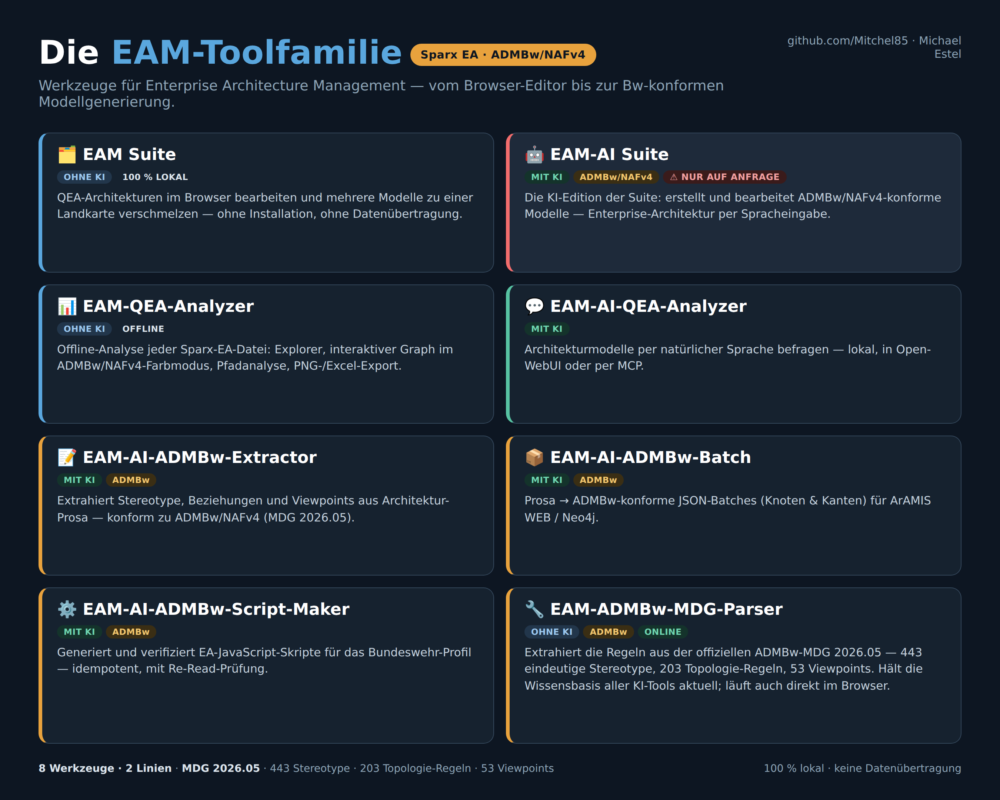

# Enterprise Architekturmagement & ADMBw

**EAM-Toolfamilie:**

  

| Tool | Was es kann | Online ausprobieren | GitHub |
|---|---|---|---|
| 🗂️ **EAM Suite** | QEA-Architekturen im Browser bearbeiten und mehrere Modelle zu einer Landkarte verschmelzen — ohne KI, ohne Installation | [mitchel85.github.io/EAM-Suite](https://mitchel85.github.io/EAM-Suite/) | [Repository](https://github.com/Mitchel85/EAM-Suite) |
| 🤖 **EAM-AI Suite** | KI-Edition der Suite: erstellt und bearbeitet ADMBw/NAFv4-konforme Modelle per Spracheingabe | ⚠️ **nur auf Anfrage** | ⚠️ **nur auf Anfrage** |
| 📊 **EAM-QEA-Analyzer** | Offline-Analyse jeder Sparx-EA-Datei: Explorer, ADMBw/NAFv4-Farb-Graph, Pfadanalyse, PNG-/Excel-Export | [mitchel85.github.io/EAM-QEA-Analyzer](https://mitchel85.github.io/EAM-QEA-Analyzer/) | [Repository](https://github.com/Mitchel85/EAM-QEA-Analyzer) |
| 💬 **EAM-AI-QEA-Analyzer** | Architekturmodelle per natürlicher Sprache befragen — lokal, in Open-WebUI oder per MCP | — | [Repository](https://github.com/Mitchel85/EAM-AI-QEA-Analyzer) |
| 📝 **EAM-AI-ADMBw-Extractor** | Extrahiert Stereotype, Beziehungen und Viewpoints aus Architektur-Prosa — konform zu ADMBw v2025.10 | — | [Repository](https://github.com/Mitchel85/EAM-AI-ADMBw-Extractor) |
| 📦 **EAM-AI-ADMBw-Batch** | Prosa → ADMBw-konforme JSON-Batches (Knoten & Kanten) für ArAMIS WEB / Neo4j | — | [Repository](https://github.com/Mitchel85/EAM-AI-ADMBw-Batch) |
| ⚙️ **EAM-AI-ADMBw-Script-Maker** | Generiert und verifiziert EA-JavaScript-Skripte für das Bundeswehr-Profil — idempotent, mit Re-Read-Prüfung | — | [Repository](https://github.com/Mitchel85/EAM-AI-ADMBw-Script-Maker) |
| 🔧 **EAM-ADMBw-MDG-Parser** | Extrahiert die Regeln aus der offiziellen ADMBw-MDG — hält die Wissensbasis aller KI-Tools bei jedem Update aktuell | [mitchel85.github.io/EAM-ADMBw-MDG-Parser](https://mitchel85.github.io/EAM-ADMBw-MDG-Parser/) | [Repository](https://github.com/Mitchel85/EAM-ADMBw-MDG-Parser) |

---

**Grundlage:** offizielle ADMBw-MDG der Bundeswehr — 443 eindeutige Stereotype · 203 Topologie-Regeln · 53 NAFv4-Viewpoints.

Interesse an der **KI-Edition (EAM-AI Suite)**? Einfach melden.
